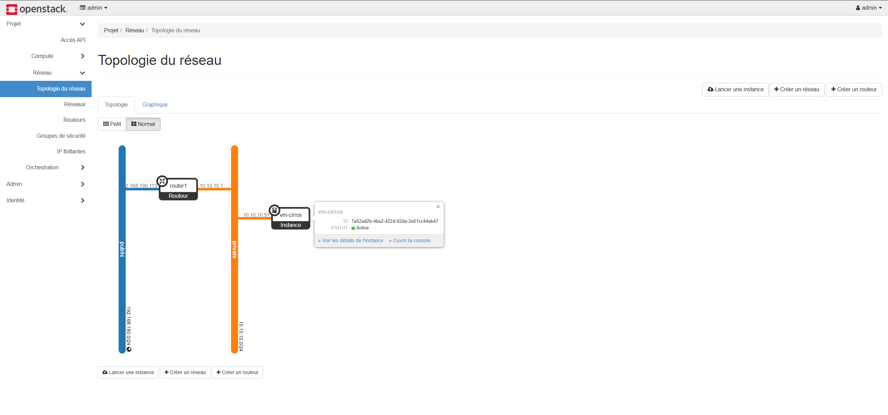

# ☁️ Mon propre cloud OpenStack sur une seule machine


> **En une phrase :** j'ai transformé une machine virtuelle Ubuntu en un **petit cloud privé** (un mini « Amazon Web Services » perso). J'ai ensuite créé dans ce cloud une VM, joignable depuis mon PC Windows.

Ce dépôt est écrit pour être compris **même sans rien connaître** à OpenStack. Tous les mots techniques sont expliqués. 👉 Le compte-rendu complet, étape par étape, avec toutes les captures, est dans [`docs/compte-rendu.md`](docs/compte-rendu.md).

> Projet réalisé pendant la semaine de formation **Virtualisation**, après le TP VMware ESXi.

---

## 📖 Les mots à connaître avant de lire

| Mot | Explication simple |
|---|---|
| **VM (machine virtuelle)** | Un faux ordinateur, simulé par un logiciel, qui tourne dans un vrai ordinateur |
| **Hyperviseur** | Le logiciel qui fait tourner les VM (VMware, ESXi, KVM, QEMU…) |
| **Cloud / IaaS** | Obtenir des VM, des réseaux et du stockage **en libre-service**, en quelques secondes, sans toucher au matériel |
| **OpenStack** | Un logiciel **gratuit** qui transforme des serveurs en cloud. C'est un ensemble de petits services, chacun avec son rôle. |
| **Conteneur / Docker** | Une « boîte » isolée qui contient un programme et tout ce dont il a besoin. Docker est l'outil qui fabrique ces boîtes. |
| **Ansible** | Un outil qui exécute automatiquement une « recette » d'installation (un *playbook*) |
| **Kolla-Ansible** | Kolla emballe chaque service OpenStack dans un conteneur Docker, et Ansible installe le tout automatiquement |
| **All-in-One** | Tout OpenStack sur **une seule** machine. Parfait pour apprendre, jamais en production. |

### Les services OpenStack, avec l'analogie de l'hôtel 🏨

| Service | Rôle | Dans un hôtel… |
|---|---|---|
| **Keystone** | Vérifie qui tu es et te donne un « jeton » (badge) | La réception |
| **Nova** | Crée et gère les VM (appelées « instances ») | Le service qui prépare les chambres |
| **Glance** | Stocke les images (les disques modèles des VM) | Le catalogue des modèles de chambres |
| **Neutron** | Gère le réseau : IP, routeurs, pare-feu | L'électricien et le standard téléphonique |
| **Placement** | Sait où il reste de la place (CPU, RAM, disque) | Le tableau des chambres libres |
| **Horizon** | Le site web pour tout gérer à la souris | Le site internet de l'hôtel |

---

## 🎯 Résultat : ça marche !

| Test | Résultat | Ce que ça prouve |
|---|---|---|
| Installation d'OpenStack | ✅ `failed=0` en environ 12 min | Kolla-Ansible a tout installé sans erreur |
| VM `vm-cirros` | ✅ `ACTIVE` | Nova, Glance et Placement fonctionnent |
| IP privée `10.10.10.91` | ✅ | Neutron distribue bien les adresses |
| IP flottante `192.168.190.105` | ✅ | La VM est joignable depuis l'extérieur |
| `ping` depuis Windows | ✅ 0 % de perte | Le réseau fonctionne de bout en bout |
| `ssh` depuis Windows | ✅ connexion par clé | Le pare-feu et la clé SSH fonctionnent |
| La VM va sur Internet | ✅ | Le routeur virtuel fait bien sortir le trafic |
| Site web Horizon | ✅ `http://192.168.190.11` | L'interface web fonctionne |



*Ce schéma vient d'Horizon. Il se lit ainsi : le réseau `public` (le vrai réseau VMware) ↔ le routeur `router1` ↔ le réseau `private` (interne au cloud) ↔ la VM `vm-cirros`.*

---

## 🏗️ Comment c'est construit

```
 PC Windows 11 (VMware Workstation)
 └── Réseau VMware NAT « VMnet8 » : 192.168.190.0/24 (sortie Internet par .2)
      └── VM Ubuntu 24.04 « openstack-aio » (8 processeurs, 16 Go de RAM, 100 Go de disque)
           ├── Carte ens33 : 192.168.190.10  → pour administrer + site web (adresse .11)
           └── Carte ens34 : SANS IP         → « câble » réservé au réseau d'OpenStack
                                              │
                                     réseau « public » (vers l'extérieur)
                                              │
                                      router1 (192.168.190.113)
                                              │
                                     réseau « private » 10.10.10.0/24
                                              │
                         vm-cirros : 10.10.10.91  ⇄  IP flottante 192.168.190.105
```

### 💡 Les 4 idées clés pour comprendre

**1. Pourquoi deux cartes réseau ?**
- `ens33` sert à **administrer** la machine.
- `ens34` est donnée **entièrement** à Neutron, qui s'en sert comme d'un câble vers l'extérieur.

Elle n'a **pas d'IP**, sinon Ubuntu et Neutron se disputeraient la carte.

**2. C'est quoi une IP flottante ?**
La VM n'a qu'une adresse privée (`10.10.10.91`), invisible depuis Windows. L'**IP flottante** (`192.168.190.105`) est une adresse « extérieure » que le **routeur** redirige vers la VM. C'est comme un numéro de téléphone direct que la réception d'un hôtel transfère vers ta chambre. La VM elle-même ne connaît **pas** cette adresse.

**3. Pourquoi QEMU et pas KVM ?**
**KVM** est rapide, mais il a besoin de **VT-x**, une fonction du processeur Intel. Sur mon PC, VT-x doit rester **désactivé** dans VMware, sinon la VM ne démarre pas. On utilise donc **QEMU**, qui imite le processeur par logiciel : c'est plus lent, mais ça marche.

**4. Qu'est-ce qu'il faut pour créer une VM dans OpenStack ?**
Il faut 6 ingrédients :
- une **image** (le système) ;
- un **gabarit** (la taille) ;
- un **réseau** ;
- un **routeur** ;
- un **groupe de sécurité** (le pare-feu) ;
- une **clé SSH** (pour se connecter).

| Élément | Valeur |
|---|---|
| Hyperviseur des VM | **QEMU** (pas de VT-x dans la VM) |
| Adresse du site web et des API (VIP) | `192.168.190.11` |
| IP flottantes disponibles | `192.168.190.100` → `.120` |
| Services installés | Keystone, Glance, Nova, Neutron (Open vSwitch), Placement, Heat, Horizon |

---

## 📁 Ce qu'il y a dans ce dépôt

```
.
├── README.md                    ← tu es ici
├── docs/
│   └── compte-rendu.md          ← le TP complet, expliqué pas à pas (aussi sur HackMD)
├── config/
│   ├── globals.d/00-aio.yml     ← les réglages donnés à Kolla-Ansible (commentés)
│   └── netplan/60-ens34.yaml    ← active la carte ens34 sans lui donner d'IP
├── scripts/
│   ├── 01-installation-kolla.sh ← installe Kolla-Ansible et déploie OpenStack
│   └── 02-validation-cirros.sh  ← crée réseaux, routeur, pare-feu, clé, VM et IP flottante
└── captures/                    ← les 43 captures d'écran, numérotées dans l'ordre du TP
```

---

## 🚀 Refaire le TP (version résumée)

**Ce qu'il faut avant de commencer :**
- une VM **Ubuntu Server 24.04** (pas 26.04 !) avec 8 processeurs, 16 Go de RAM et 100 Go de disque ;
- **deux cartes réseau** : une avec une IP fixe (`ens33`), une sans IP (`ens34`) ;
- un utilisateur qui peut faire `sudo` sans mot de passe (Ansible en a besoin).

```bash
# 1. Activer la 2e carte réseau sans lui donner d'adresse IP
sudo cp config/netplan/60-ens34.yaml /etc/netplan/ && sudo chmod 600 /etc/netplan/60-ens34.yaml
sudo netplan apply

# 2. Installer Kolla-Ansible et déployer OpenStack (15-20 min)
./scripts/01-installation-kolla.sh

# 3. Charger l'environnement Python et les identifiants admin, puis créer la VM de test
source ~/kolla-venv/bin/activate
source /etc/kolla/admin-openrc.sh
./scripts/02-validation-cirros.sh
```

Le déploiement se fait en 4 commandes Kolla, toujours dans cet ordre :

| Ordre | Commande | Rôle | Analogie |
|---|---|---|---|
| 1 | `bootstrap-servers` | Prépare la machine (installe Docker…) | Préparer le terrain |
| 2 | `prechecks` | Vérifie que tout est prêt | Contrôle avant travaux |
| 3 | `deploy` | Installe et lance tous les services | Construire la maison |
| 4 | `post-deploy` | Crée les fichiers de connexion admin | Remettre les clés |

> ⚠️ Avant de lancer les scripts, adapte les noms de cartes réseau, la VIP et les plages d'IP à **ton** réseau.

---

## 🛠️ Les problèmes que j'ai rencontrés (et comment je les ai réglés)

| Problème | Pourquoi | Solution |
|---|---|---|
| Ubuntu met 2 min à démarrer (`systemd-networkd-wait-online`) | Ubuntu attend que **toutes** les cartes aient une IP, mais `ens34` n'en a volontairement pas | Ajouter `optional: true` pour `ens34` dans netplan (« n'attends pas cette carte ») |
| `prechecks` échoue : `No module named 'docker'` | Le module Python `docker` était installé dans le Python d'Ubuntu, alors que Kolla tourne dans un **venv** (un Python isolé) qui ne le voit pas | `pip install docker dbus-python` **dans** le venv |
| La VM VMware ne démarre pas avec VT-x coché | Conflit avec Hyper-V (la virtualisation de Windows) | Décocher VT-x, donc utiliser `nova_compute_virt_type: qemu` |

Le détail de chaque problème est expliqué dans le [compte-rendu](docs/compte-rendu.md#12-Problèmes-rencontrés-et-solutions).

---

## 🔒 Sécurité : ce qui n'est PAS dans ce dépôt

Certains fichiers contiennent des **mots de passe** ou des **clés secrètes**. Ils sont bloqués par le fichier [`.gitignore`](.gitignore), la liste des fichiers que Git ne doit jamais envoyer sur GitHub.

| Fichier | Ce qu'il contient |
|---|---|
| `/etc/kolla/passwords.yml` | **Tous** les mots de passe du cloud |
| `admin-openrc.sh`, `clouds.yaml` | Les identifiants de l'administrateur |
| `openstack_key` (clé privée SSH) | La « clé » qui ouvre les VM |

Aucune capture d'écran ne montre de mot de passe.

---

## 🧠 Les 5 choses à retenir

1. **OpenStack** = un logiciel qui transforme des serveurs en **cloud**, posé au-dessus des hyperviseurs.
2. **Kolla-Ansible** = OpenStack en **conteneurs Docker**, installé **automatiquement** par Ansible.
3. Il faut **Ubuntu 24.04** pour OpenStack 2025.2, et **deux cartes réseau** (une **sans IP** pour Neutron).
4. Pas de **VT-x** dans la VM, donc pas de KVM, donc **QEMU**.
5. L'**IP flottante** permet de joindre une VM depuis l'extérieur : c'est le **routeur** qui fait la traduction.

---

## 📚 Pour aller plus loin

- [Kolla-Ansible – Guide de démarrage (2025.2)](https://docs.openstack.org/kolla-ansible/2025.2/user/quickstart.html)
- [Documentation officielle d'OpenStack](https://docs.openstack.org/2025.2/)
- [Cirros – petites images Linux de test](https://download.cirros-cloud.net/)

---

**Auteur :** Lami ([@L4ami](https://github.com/L4ami)) · Octobre 2026
